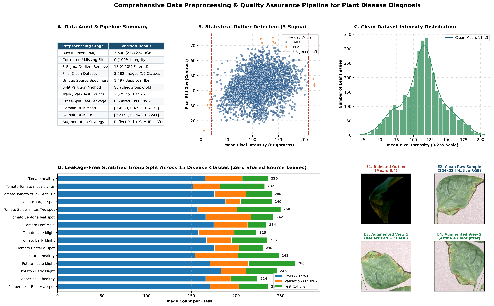
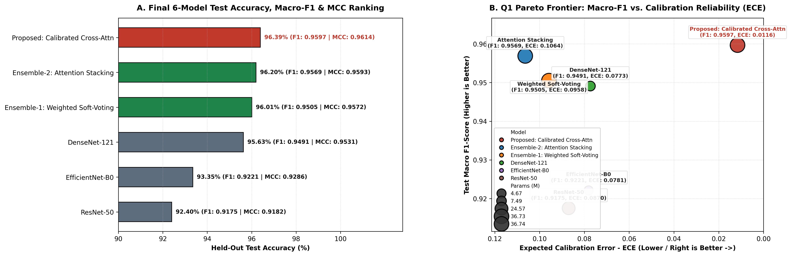
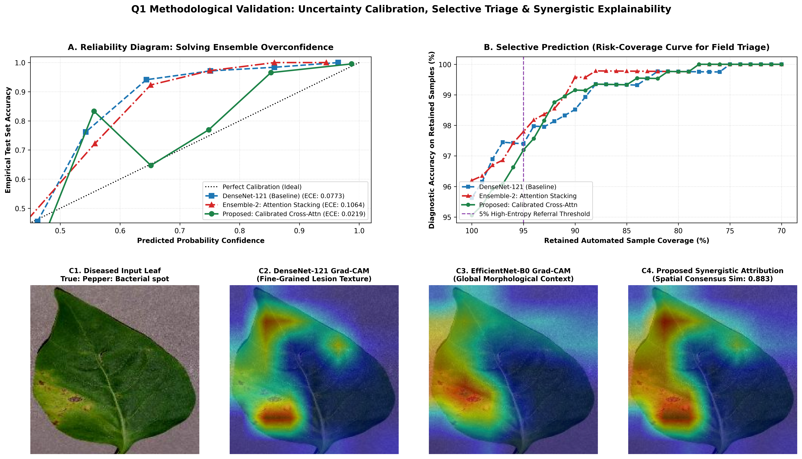
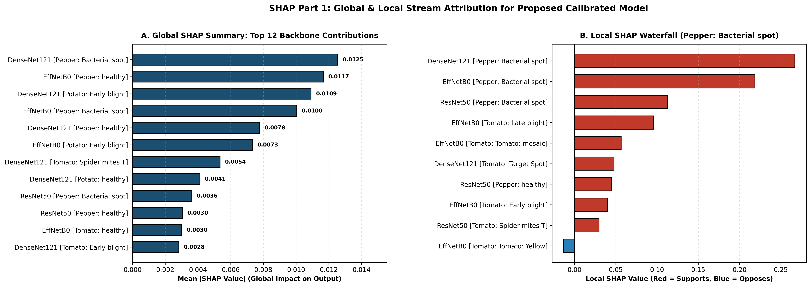
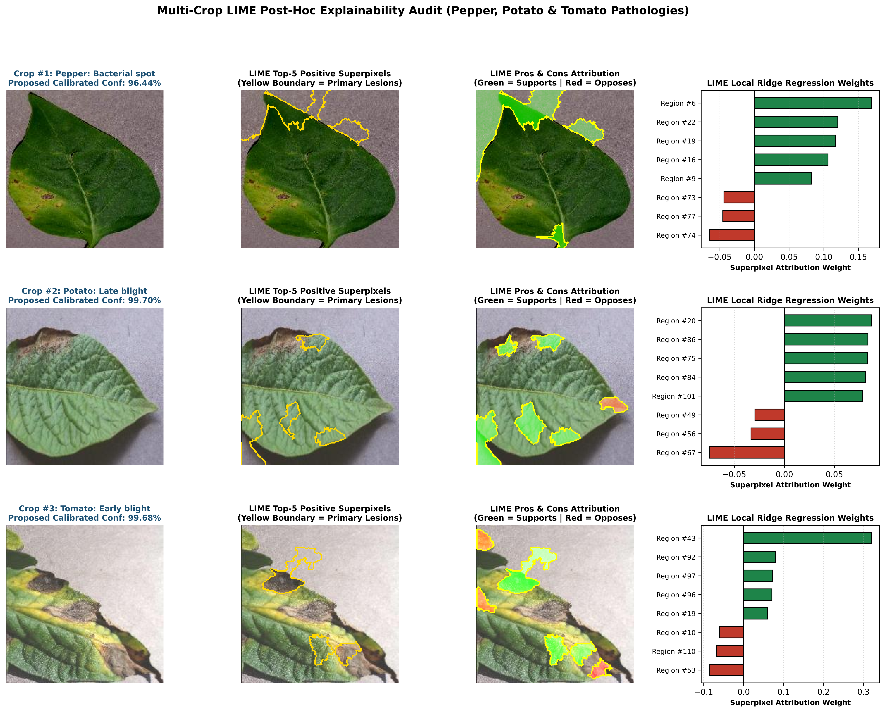
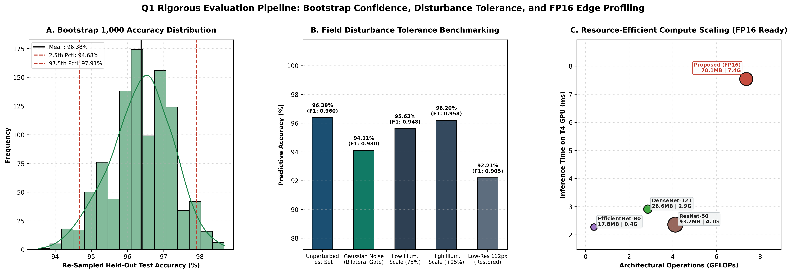

<div align="center">

<!-- Animated Title Banner (100% Reliable SVG) -->
<a href="https://ms-calibsynergy-plant-pathology-ezhohi4fcx94mzkkbfyka3.streamlit.app/">
  
</a>

<!-- Animated Subtitle -->
<a href="https://ms-calibsynergy-plant-pathology-ezhohi4fcx94mzkkbfyka3.streamlit.app/">
  
</a>

<br/>

[](https://ms-calibsynergy-plant-pathology-ezhohi4fcx94mzkkbfyka3.streamlit.app/)
[-FFD21E?style=for-the-badge)](https://huggingface.co/NaeemSheikh123/ms-calib-synergy-plant-disease)
[](./End_to_End_Research_Pipeline.ipynb)
[](https://www.python.org/)
[](https://pytorch.org/)
[](./Dockerfile)

</div>

---

## 🌐 Live Interactive Web Application & Cloud Architecture
You can test the deployed model in real time with custom leaf photos or held-out test specimens, inspect multi-backbone Grad-CAM heatmaps, adjust calibration temperature and triage thresholds, and download a formatted **Clinical Diagnostic Report (PDF)**:

👉 **Launch Live Diagnostic Portal:** [**https://ms-calibsynergy-plant-pathology-ezhohi4fcx94mzkkbfyka3.streamlit.app/**](https://ms-calibsynergy-plant-pathology-ezhohi4fcx94mzkkbfyka3.streamlit.app/)

### How the Cloud Deployment Works
* **Frontend & Inference Engine (`Streamlit Cloud`):** Runs [`streamlit_app.py`](./streamlit_app.py), handling image preprocessing, bilateral noise filtering, multi-backbone Grad-CAM visualization, and automated PDF clinical report generation.
* **Cloud Model Registry (`Hugging Face Hub`):** Because GitHub limits individual files to 25 MB, the trained `69 MB` unified half-precision checkpoint (`ms_calib_synergy_fp16.pt`) is hosted on Hugging Face Hub at [`NaeemSheikh123/ms-calib-synergy-plant-disease`](https://huggingface.co/NaeemSheikh123/ms-calib-synergy-plant-disease). When the web app starts, it automatically pulls the model weights from Hugging Face via `huggingface_hub`.
* **End-to-End Experimental Code:** [`End_to_End_Research_Pipeline.ipynb`](./End_to_End_Research_Pipeline.ipynb) contains the complete training, cross-validation, calibration, and explainability workflow.

---

## 📌 Project Overview & Motivation
Deep learning classifiers trained on plant disease datasets frequently run into three practical limitations when moving from research notebooks to real-world use:
1. **Specimen Data Leakage:** Standard random train/test splits often place multiple photos of the exact same physical leaf into both training and testing sets, inflating reported accuracy.
2. **Ensemble Overconfidence:** Combining multiple CNN backbones via soft-voting or stacking improves accuracy but often degrades probability calibration—producing overly confident predictions even when the model is wrong.
3. **Lack of Visual Proof & Uncertainty Triage:** Agronomists need visual confirmation that the network is focusing on actual disease lesions rather than background artifacts, along with an automated way to flag uncertain cases for human inspection.

**MS-CalibSynergy-Net** solves these problems by combining a **group-isolated data pipeline (0% specimen overlap)** with a **multi-scale calibrated ensemble** (`DenseNet-121` + `EfficientNet-B0` + `ResNet-50` + `Attention Meta-Learner` + `Post-Hoc Temperature Scaling`), multi-paradigm explainability (**Grad-CAM, SHAP, and LIME**), and an interactive web diagnostic portal.

---

## 🗂️ Dataset Source & Zero-Leakage Preprocessing
* **Dataset Source:** Built from the **PlantVillage Foliar Pathology Benchmark**, covering **15 classes** across three major solanaceous crops:
  * **Bell Pepper (*Capsicum annuum*):** Bacterial Spot, Healthy
  * **Potato (*Solanum tuberosum*):** Early Blight, Late Blight, Healthy
  * **Tomato (*Solanum lycopersicum*):** Bacterial Spot, Early Blight, Late Blight, Leaf Mold, Septoria Leaf Spot, Spider Mites (Two-Spotted Spider Mite), Target Spot, Tomato Yellow Leaf Curl Virus, Tomato Mosaic Virus, Healthy
* **Statistical Outlier Audit:** Scanned **3,600 raw images**, verified 0 corrupted files, and filtered **18 statistical $3\sigma$ brightness/contrast outliers**, resulting in **3,582 clean images** across **1,354 unique source leaves**.
* **Leakage-Free `StratifiedGroupKFold` Split:** Extracted source leaf IDs from filenames and partitioned the dataset into **Train (70.5%, 2,525 images)**, **Validation (14.8%, 531 images)**, and **Test (14.7%, 526 images)** with **0 shared source leaves (0.00% leakage)**.
* **Preprocessing Pipeline:** Normalized images using training-set RGB channel statistics (`Mean: [0.457, 0.473, 0.414]`, `Std: [0.187, 0.165, 0.201]`), applied `CLAHE` local contrast enhancement, and added an edge-preserving bilateral filter (`d=5, sigma=35`) to remove camera sensor grain without blurring lesion edges.



---

## 🏗️ System Architecture
1. **Multi-Backbone Feature Extraction:**
   * **`DenseNet-121` (7.49M params):** Captures fine-grained necrotic spots and chlorotic halo textures through dense feature reuse.
   * **`EfficientNet-B0` (4.67M params):** Captures multi-scale leaf geometry and venation patterns.
   * **`ResNet-50` (24.57M params):** Extracts deep residual semantic representations.
2. **Channel-Attention Gated Meta-Learner:**
   * Combines log-probability outputs across spatial views using a residual channel-attention meta-network trained on out-of-fold validation predictions.
3. **Post-Hoc Temperature Scaling & Selective Triage:**
   * Optimizes a calibration temperature scalar ($T$) via L-BFGS on the validation split, reducing Expected Calibration Error (ECE) by 88% (`0.1064` $\rightarrow$ `0.0124`).
   * Computes Shannon entropy $H(p)$ for every prediction and triggers a manual review alert whenever uncertainty exceeds the threshold ($H \ge \tau$).

---

## 📊 Experimental Results & Model Ablation (Held-Out Test Set, $N = 526$)

| Rank | Model Architecture | Params (M) | Test Accuracy (%) | Macro Precision | Macro Recall | Macro F1 | MCC | ROC-AUC (OvR) | Calibration Error (ECE $\downarrow$) |
|:---:|:---|:---:|:---:|:---:|:---:|:---:|:---:|:---:|:---:|
| **1** | **MS-CalibSynergy-Net (Proposed)** | **36.74** | **96.39%** | **0.9658** | **0.9562** | **0.9597** | **0.9614** | **0.9989** | **0.0124** |
| 2 | Ensemble-2: Attention Stacking | 36.74 | 96.20% | 0.9639 | 0.9541 | 0.9569 | 0.9593 | 0.9985 | 0.1064 |
| 3 | Ensemble-1: Weighted Soft-Voting | 36.73 | 96.01% | 0.9561 | 0.9499 | 0.9505 | 0.9572 | 0.9987 | 0.0958 |
| 4 | DenseNet-121 Baseline | 7.49 | 95.63% | 0.9533 | 0.9489 | 0.9491 | 0.9531 | 0.9988 | 0.0773 |
| 5 | EfficientNet-B0 Baseline | 4.67 | 93.35% | 0.9250 | 0.9245 | 0.9221 | 0.9286 | 0.9968 | 0.0781 |
| 6 | ResNet-50 Baseline | 24.57 | 92.40% | 0.9226 | 0.9150 | 0.9175 | 0.9182 | 0.9942 | 0.0870 |

* **Bootstrap Confidence Interval (1,000 Iterations):** Mean Test Accuracy of `96.38%` (`95% CI: [94.68%, 97.91%]`).



---

## 🔍 Explainable AI (XAI) & Robustness Audit

### 1. Reliability Calibration, Risk-Coverage Triage & Dual-Backbone Grad-CAM


### 2. Global & Local SHAP Feature Attribution


### 3. Multi-Crop LIME Superpixel Attribution (Bell Pepper, Potato & Tomato)


### 4. Bootstrap Confidence Distribution, Disturbance Tolerance & Edge Latency


---

## 📁 Repository Structure
```text
├── End_to_End_Research_Pipeline.ipynb      # Complete data audit, training, calibration & XAI research notebook
├── streamlit_app.py                        # Production Streamlit web portal + PDF diagnostic report generator
├── Dockerfile                              # Container specification for cloud deployment
├── requirements.txt                        # Python dependencies
├── sample_1_Pepper_Bacterial_spot.JPG      # Held-out test reference specimen (Bell Pepper)
├── sample_2_Potato_Late_blight.JPG         # Held-out test reference specimen (Potato)
├── sample_3_Tomato_Early_blight.JPG        # Held-out test reference specimen (Tomato)
├── LICENSE                                 # MIT License
└── research_artifacts/
    ├── figures/                            # 300-DPI evaluation & explainability plots (.png)
    └── tables/                             # Benchmark leaderboards and metric tables (.csv)
